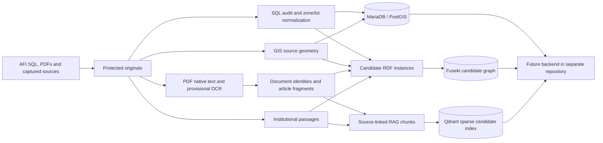
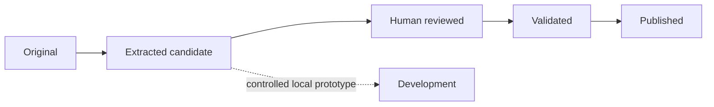

# Dalila DATA2: data foundation and team setup

Dalila is a planned multilingual industrial-investment assistant for Tunisia. AFI (Agence Foncière Industrielle) supplies industrial-zone, lot and regulatory material. DATA2 prepares evidence-backed data for a **future, separate backend**; it does not implement a chatbot. The eight required languages are Tunisian Arabic (including Arabizi and code-switching), French, English, Modern Standard Arabic, Algerian Arabic, Libyan Arabic, German and Turkish.

> **Access boundary:** this public GitHub repository contains project-authored tools, ontology, schemas, manifests and 224 synthetic evaluation drafts. It **does not contain original AFI SQL, PDFs, OCR, institutional passages, lots, GIS, retrieval chunks or RDF instances**. The owner confirmed no written public redistribution permission exists for the source material. [APII's official legal notice](https://www.tunisieindustrie.nat.tn/fr/doc.asp?mcat=25&mrub=205) also requires prior written authorization for redistribution of its site content. Other source rights need individual review. Actual candidate data requires a separately approved, encrypted transfer; no team download location is configured. See [publication boundary](docs/PUBLICATION_BOUNDARY.md).

## Contents

1. [Quick start](#quick-start)
2. [Measured dataset inventory](#measured-dataset-inventory)
3. [Repository and archive layout](#repository-and-archive-layout)
4. [Preparation and architecture](#preparation-and-architecture)
5. [Database interfaces](#database-interfaces)
6. [Using candidate datasets](#using-candidate-datasets)
7. [Backend integration](#backend-integration)
8. [Quality and release limits](#quality-and-release-limits)
9. [Access and recovery](#access-and-recovery)
10. [Troubleshooting and FAQ](#troubleshooting-and-faq)

## Quick start

On Windows, with Python 3.11+, Git and Docker Desktop installed (Python 3.11 was tested):

```powershell
git clone https://github.com/mohamedyassineabdi/DATA2.git
cd DATA2
.\setup_data.ps1
```

This verifies the public manifest, creates `.venv` and installs pinned dependencies. **Without an authorized archive it finishes a public-only setup and does not create empty databases.** No source corpus is downloaded from an unapproved location.

After the owner provides an approved, encrypted transfer and you decrypt it locally to the original ZIP bytes:

```powershell
.\setup_data.ps1 -Archive 'C:\approved\DATA2_local_candidate_v2.zip'
```

The script checks the known v2 SHA-256, rejects unsafe ZIP paths, stages extraction, verifies every mapped file, generates local credentials, selects free loopback ports, starts isolated containers, imports four candidate stores and runs smoke queries. Re-running verifies installed files and complete database targets; it never silently overwrites them or deletes volumes. **The ZIP itself is not encrypted or approved for transfer.** Source rights, privacy and named-recipient access must be approved first.

Linux/macOS uses `./setup_data.sh --archive /approved/DATA2_local_candidate_v2.zip` (or `sh setup_data.sh` if executable permission was not retained). The public-only command is `./setup_data.sh`.

Implemented modes and options:

```powershell
.\setup_data.ps1 -Mode data-only -Archive 'C:\approved\DATA2_local_candidate_v2.zip'
.\setup_data.ps1 -Mode db-only
.\setup_data.ps1 -Mode verify
.\setup_data.ps1 -Mode load-mariadb
.\setup_data.ps1 -Mode load-postgis
.\setup_data.ps1 -Mode load-fuseki
.\setup_data.ps1 -Mode load-qdrant
```

`data-only` verifies the corpus without Docker; `db-only` starts isolated services without importing or overwriting data; `verify` checks installed files and reachable database targets. Individual `load-*` modes require the data and `.venv` from an earlier run. `-WithRedis` adds optional Redis. `-Project dalila-data2-<name>` selects another isolated project; `-SkipDependencies` uses an existing `.venv`. The shell wrapper takes corresponding `--mode`, `--archive`, `--project`, `--with-redis`, `--skip-dependencies` options.

An approved HTTPS team-storage endpoint may be used with `-ArchiveUrl <url> -ArchiveSha256 <64-hex-digest>`; set `DATA2_ARCHIVE_BEARER_TOKEN` in your local shell for bearer authentication. No endpoint is approved/configured today. Downloads stay in ignored `local_only/transfer_pending/`, use HTTPS and resume only if the server honors byte ranges. Never put tokens in URLs or Git. A nonstandard local archive also requires `-ArchiveSha256`.

## Measured dataset inventory

Counts and sizes were measured in the protected local copy on 2026-11-26. Paths are repository-relative. `local_only/` appears **only after authorized transfer**. `P` is public Git; `L` is protected local archive. Source-derived records are unreviewed candidates. The full per-file path, format, byte count, source mapping and SHA-256 are in `local_only/audit/dataset_manifest.json` after installation.

| Dataset | Relative path | Format; bytes | Records / source | State, access and use |
| --- | --- | --- | --- | --- |
| Original AFI SQL | `local_only/data/original/sql/afi.sql` | SQL; 4,114,653 | 13 tables, 15,841 rows; supplied AFI dump | Original restricted; L; isolated MariaDB |
| Original/recovered PDFs | `local_only/data/original/pdfs/`, `local_only/data/original/web/` | PDF; 1,076,040,693 | 114 unique hashes, 3,396 pages; catalog/captured URLs | Original, rights pending; L; evidence |
| Pilot images | `local_only/data/original/ocr_pilot/images/` | PNG; 86,140,908 | 30 pages | L; transcription review |
| OCR checkpoints | `local_only/data/processed/ocr/best/pages/` | JSON; 9,608,683 | 2,996 pages; provisional Tesseract Best | Unvalidated; L; page candidates |
| Regulatory fragments | `local_only/data/processed/regulations_and_institutional/article_candidates.jsonl` | JSONL; 10,692,806 | 7,587; PDF native/OCR | Unvalidated; L; review/RAG candidate |
| Institutional passages | `local_only/data/processed/regulations_and_institutional/institutional_passages.jsonl` | JSONL; 2,715,966 | 2,794; captured content | Unvalidated; L; review/RAG candidate |
| Retrieval chunks | `local_only/data/processed/retrieval/chunks.jsonl` | JSONL; 12,419,396 | 10,381 article/passage chunks | Unvalidated; L; candidate Qdrant input |
| Normalized zones | `local_only/data/processed/relational/zones.jsonl` | JSONL; 123,873 | 185; SQL-derived | Unvalidated; L; candidate read model |
| Normalized lots | `local_only/data/processed/relational/lots.jsonl` | JSONL; 3,432,211 | 6,579; SQL-derived | Unvalidated; L; candidate read model |
| Plot observations | `local_only/data/processed/public_plot_observation/records.jsonl` | JSONL; 239,161 | 720; dated public search capture | L; historical, not live availability |
| GIS candidates | `local_only/data/processed/gis/candidates/candidates.jsonl` | JSONL; 12,229,005 | 12,006; archive/SQL-derived | Unvalidated; L; staging, CRS unresolved |
| RDF instance graph | `local_only/data/processed/knowledge_graph/candidate.ttl` | Turtle; 11,526,015 | 93,495 triples; derived candidates | Unvalidated; L; Fuseki candidate graph |
| Cleaned web pages | `local_only/data/processed/institutional/pages/pages.jsonl` | JSONL; 1,344,740 | 345; captured institutional text | Unvalidated; L; page evidence |
| Structured web candidates | `local_only/data/processed/institutional/structured/candidates.jsonl` | JSONL; 1,515,712 | 977; cleaned pages | Unvalidated; L; procedural review |
| Identity matrix | `local_only/data/review/document_identities/matrix.json` | JSON; 73,814 | 106 catalog references | Unreviewed; L; identity decisions |
| Review packets | `local_only/data/review/prioritized_packets/packets.jsonl` | JSONL; 13,881,164 | 6,905 tasks | Unreviewed; L; human validation |
| Vocabulary/constraints | `ontology/dalila.ttl`, `ontology/dalila-shapes.ttl` | Turtle; 5,156 + 1,414 | 157 ontology, 69 SHACL triples | Project-authored; P; schemas |
| Multilingual eval drafts | `schemas/examples/multilingual-evaluation-drafts.json` | JSON; 228,891 | 224 cases, 28/language | Synthetic draft; P; no gold answers |

Three exact PDF duplicates explain 117 source paths but 114 physical PDFs. The table highlights major families within the 3,374-file local copy; see [catalog](docs/DATA_CATALOG.md) and the local manifest for every file. Historical AFI HTML/JSON capture bodies could not be re-exported because `AFI_Replica_Local.zip` was unavailable; the 345 processed web page candidates remain.

## Repository and archive layout

```text
DATA2/
  README.md, DATA_STATUS.md, setup_data.ps1, setup_data.sh, requirements.txt
  docs/                 catalog, dictionary, architecture, quality, verification
  infrastructure/       loopback Compose and env.example; .env is ignored
  manifests/            public checksums and release/source metadata
  ontology/             OWL/RDF vocabulary, SHACL and SPARQL examples
  schemas/              article/evaluation contracts and synthetic drafts
  scripts/              setup, consolidation, import and verification programs
  tests/                synthetic safety and structural tests
  local_only/            ignored: data/, audit/, transfer_pending/
    data/original/      preserved SQL, PDFs, pilot evidence
    data/processed/     OCR, relational, GIS, RDF, knowledge, retrieval
    data/review/        identity matrix and review packets
    audit/              per-file hashes, source mapping and quality reports
```

The archive contains `data/` and `audit/`; setup places these beneath `local_only/`. Teammates with this archive do **not** need the historical Dalila workspace. The original workspace and frozen 30-dataset manifest remain untouched.

## Preparation and architecture

AFI SQL and document/catalog sources were inventoried with SHA-256 and IDs. Captured web URLs supplied additional PDFs; exact-hash deduplication produced 114 unique documents. Native PDF text and provisional Tesseract Best OCR yielded page candidates; empty OCR pages retain alternatives. Cover titles, URLs, zone names and SQL metadata informed a 106-reference reconciliation matrix. No identity was confirmed solely from a zone name.

Article fragments and institutional passages retain source/page/body hashes. Normalized zone/lot JSONL preserves original fields and raw status codes; it does not infer AFI availability rules. The 720 plot rows are a dated search snapshot. GIS preserves original geometries and unknown CRS, flagging invalid/missing records instead of repairing in place. RDF instances and retrieval chunks are derived candidates. SHACL and structural tests do not establish factual correctness. Qdrant reconstructs a **lexical sparse** index, not a multilingual dense model. Eight-language questions await independent judgments. The consolidation copied bytes and retained duplicate source mappings.





No candidate is automatically promoted. The backend must enforce review boundaries and cite source/date evidence. MariaDB is the operational snapshot; PostGIS and Fuseki are derived candidate stores; Qdrant is a rebuildable index. Compose binds interfaces to `127.0.0.1` and is **not** a production security design.

## Database interfaces

`setup_data.ps1 -Archive ...` writes distinct random secrets and chosen loopback ports to ignored `infrastructure/.env`; `infrastructure/env.example` lists variables. The installer requires a `dalila-data2-*` project, uses persistent volumes and refuses populated targets. Inspect services with `docker compose --env-file infrastructure/.env -f infrastructure/compose.yaml -p dalila-data2-local ps`. Stop without deleting data using the same prefix and `down` **without `-v`**. If you used `-Project`, use that project name consistently.

| Store | Purpose, schema and tested query |
| --- | --- |
| **MariaDB** | Original `afi_restricted` snapshot: `zones`, `lots`, `lots_kml`, `zone_kml`, `zone_documents`, `zone_services`, `zone_commodites`, `zone_indicateurs` and five historical `chatbot_*` tables. Source DDL determines physical keys; `lots.zone_id` to `zones.code_zone` is a logical candidate relationship with 24 unmatched normalized refs. `SELECT COUNT(*) FROM lots;` returned 6,579. Never expose chatbot/promoter records to a backend. |
| **PostGIS** | `candidate.geometry_source` has source JSONB, nullable `geom`, review state and GiST geometry index; `candidate.zone_record` and `candidate.lot_record` have JSONB source rows. The geometry SRID is **0**, never guessed. `SELECT count(*),count(geom),count(*) FILTER (WHERE geom IS NOT NULL AND ST_SRID(geom)<>0) FROM candidate.geometry_source;` returned 12,006 / 9,945 / 0. No valid spatial overlay or web-map coordinates are asserted until CRS is established. |
| **Qdrant** | Collection `dalila_candidate_lexical_<12 hex of chunks SHA-256>`, sparse vector `lexical`, payload `chunk_id`, `kind`, `text_sha256`, `review_status=unvalidated`. 10,381 IDs verified; `scripts/query_candidate_stack.py` returned three lexical hits. Dense/hybrid and multilingual quality remain unproven. |
| **Fuseki/TDB2** | Dataset `/candidate`, graph `urn:dalila:candidate:<16 hex of candidate.ttl SHA-256>`, 93,495 triples. `ontology/dalila.ttl` defines classes/properties and `ontology/dalila-shapes.ttl` SHACL constraints. A graph-scoped `SELECT (COUNT(*) AS ?n) WHERE { GRAPH <graph-id> { ?s ?p ?o } }` returned 93,495. |
| **Redis** | Optional local coordination/cache only. `-WithRedis` creates an ignored ACL and starts the `coordination` profile. No host port is published; reach it from the same Compose network. Redis is not a source of truth. |

Run the tested cross-store smoke script: `python scripts/query_candidate_stack.py --project dalila-data2-local --env-file infrastructure/.env`. SQL uses container clients; Fuseki/Qdrant use loopback HTTP with local credentials. For an independent backend, create **separate least-privilege credentials**, not installer admin secrets. See [dictionary](docs/DATA_DICTIONARY.md) for field meanings. Internal status-code semantics and current public availability are unknown.

## Using candidate datasets

These read-only examples use **actual local candidate paths** after authorized installation. They make no accuracy assertion. JSONL is UTF-8, one JSON object per line.

```python
import json
from pathlib import Path
from rdflib import Graph

root = Path('local_only/data')
def rows(relative):
    with (root / relative).open(encoding='utf-8') as source:
        for line in source:
            yield json.loads(line)

zones = list(rows('processed/relational/zones.jsonl'))
lots = list(rows('processed/relational/lots.jsonl'))
large_surface = [x for x in lots if x.get('surface_lotis_decimal')
                 and float(x['surface_lotis_decimal']) >= 1000]
observations = list(rows('processed/public_plot_observation/records.jsonl'))
articles = list(rows('processed/regulations_and_institutional/article_candidates.jsonl'))
passages = list(rows('processed/regulations_and_institutional/institutional_passages.jsonl'))
chunks = list(rows('processed/retrieval/chunks.jsonl'))
gis = list(rows('processed/gis/candidates/candidates.jsonl'))
document_hashes = {x['document_sha256'] for x in articles}
graph = Graph().parse(root / 'processed/knowledge_graph/candidate.ttl', format='turtle')
print(len(zones), len(lots), len(large_surface), len(observations),
      len(articles), len(passages), len(chunks), len(gis), len(document_hashes), len(graph))
```

For original document references, combine `document_sha256`, `source_page` and `source_urls` with the local PDF mapping; never reconstruct a filename from a guessed title. A tested PowerShell SQL aggregate is:

```powershell
@'
MYSQL_PWD="$MARIADB_ROOT_PASSWORD" mariadb -uroot afi_restricted -N -e 'SELECT COUNT(*) FROM lots;'
'@ | docker compose --env-file infrastructure/.env -f infrastructure/compose.yaml -p dalila-data2-local exec -T mariadb sh
```

It returned `6579` in the fresh-clone test. The [query script](scripts/query_candidate_stack.py) tests SQL, PostGIS, SPARQL and Qdrant without displaying source records. A frontend map must wait for reviewed, CRS-identified geometries; this repo has no map-serving endpoint.

## Backend integration

Keep application code in a separate repository. The SQL agent should use a restricted read-only projection and preserve raw status-code uncertainty. The GIS agent should use PostGIS with CRS/review flags; the frontend must not treat every geometry as display-ready. Regulatory and institutional agents should retrieve chunks with source page/body evidence, check original content and abstain on uncertain claims. The semantic agent can explore the candidate Fuseki graph while exposing its review state. Recommendation logic must not infer current sale status from historical plot observations. The multilingual assistant needs independently judged retrieval/answer evaluation across all eight languages. None of these components is implemented here.

## Quality and release limits

Structural checks passed for mapped hashes, PDF/page links, JSON/JSONL and chunk IDs. That does **not** establish OCR accuracy, legal applicability, current price, availability or geometry CRS. Thirty pilot pages need human transcription; 12 empty OCR outputs need adjudication; 106 document identities and 6,905 review packets remain pending. GIS has 13 invalid and 2,037 missing geometries; 24 lots lack a normalized zone match. The 720 plot observations are historical, and conflicting prices/status labels remain separate. Original institutional capture bodies are missing from this consolidation. Qdrant is lexical sparse only; the 224 evaluation drafts have no gold answers. Local Compose still needs production security and backup design. These limits permit controlled prototyping but block production claims. See [quality](docs/DATA_QUALITY.md) and [verification](docs/VERIFICATION.md).

## Access and recovery

The owner's archive is `C:\Users\yassi\DATA2\local_only\transfer_pending\DATA2_local_candidate_v2.zip`: **1,257,052,806 bytes**, 3,383 entries, SHA-256 `0addeb821a93e0d96bf40bc2edf893e184b221ec81d665cfbfc52514a3f0b1a2`. ZIP integrity and every canonical mapping hash passed. It is **unencrypted and local-only** pending source reuse, privacy, named-recipient and encrypted-transfer approval. No approved storage endpoint or recipients are recorded. Request access through an approved private channel; do not upload it to GitHub or external AI.

Use `-Archive` rather than manually extracting. Verify independently with `Get-FileHash -Algorithm SHA256 'C:\approved\DATA2_local_candidate_v2.zip'`. `-Mode verify` checks installed data. A wrong-hash archive is rejected before extraction. Interrupted staging remains under ignored `local_only/.setup-staging/` and can resume with the same verified archive. Existing installed `data/`/`audit/` are never overwritten. Back up volumes separately before moving machines. The original frozen 30-dataset manifest SHA-256 remains `85e1cc56941f2b960ed364bd02068adfdbce1035f059df736cee847dfba1a11e`.

## Troubleshooting and FAQ

| Symptom | Action |
| --- | --- |
| Python/Git missing | Install Python 3.11+ and Git, add to PATH, reopen shell. |
| PowerShell blocks scripts | If permitted by local policy, use `powershell -ExecutionPolicy Bypass -File .\setup_data.ps1` for one invocation. |
| Docker stopped / Compose unavailable | Start Docker Desktop; check `docker compose version`. `data-only` needs no Docker. |
| Virtual environment / pip TLS failure | Re-run setup. On pip 24/Windows, use `python -m pip install --use-feature=truststore -r requirements.txt` with the system trust store; never disable TLS verification. |
| Archive absent | Public-only setup is expected. Obtain approved encrypted transfer; Git alone has no source corpus. |
| Archive hash wrong | Compare filename, size and SHA-256 with owner; do not extract. |
| Missing candidate | Run `-Mode verify` and inspect local audit manifest; arrange authorized replacement if damaged. |
| Port collision | New setup chooses free loopback ports; existing `.env` is not rewritten. Stop the conflicting process or edit private port values deliberately. |
| Authentication failure | Use ignored `.env`; never copy owner's secrets or commit credentials. |
| Existing/partial database target | Complete targets are checked; partial targets stop for inspection. Do not delete volumes as a generic fix. |
| Qdrant/Fuseki failure | Check `docker compose ... ps` and local logs without posting source text; rerun after fixing the cause. |
| Windows path with spaces | Quote it, e.g. `-Archive 'C:\approved files\DATA2_local_candidate_v2.zip'`. |

**Where are the PDFs, cleaned data, articles, chunks and lots?** In the protected paths above. **Do I repeat OCR or scraping?** No; existing candidate outputs are in the archive. **How do I query GIS or RDF?** Use PostGIS/Fuseki with review and CRS limits. **Which source-derived datasets are validated?** None for production. **What if a dataset is missing?** Verify the archive and mapping, then request an approved transfer; do not invent records.

Remaining work is source-specific redistribution and privacy decisions, recovery of missing original capture bodies if available, OCR/document/legal/institutional review, source-specific CRS and current price/availability evidence, independently judged multilingual retrieval evaluation, and a separately secured backend. Public schemas/tooling are ready for controlled development; factual publication remains gated.
